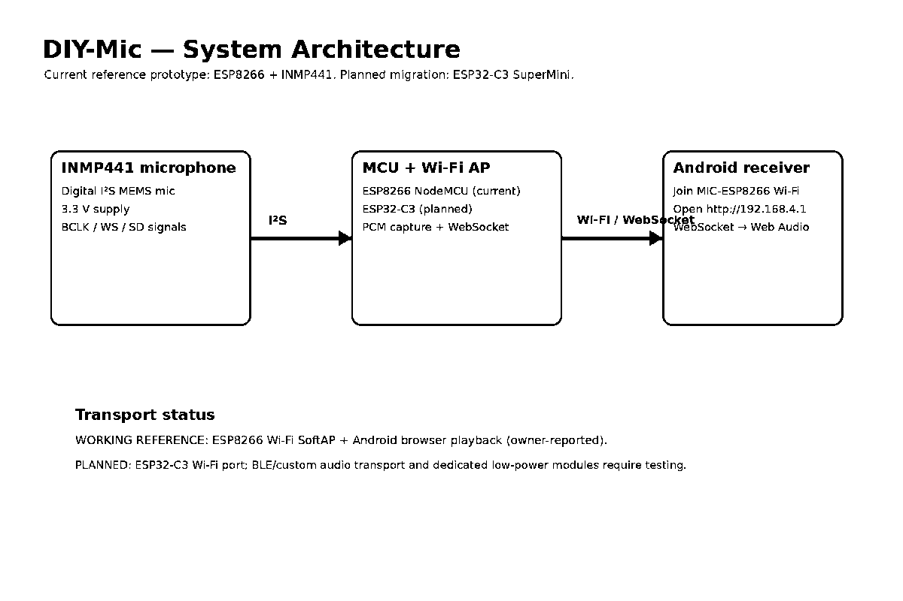
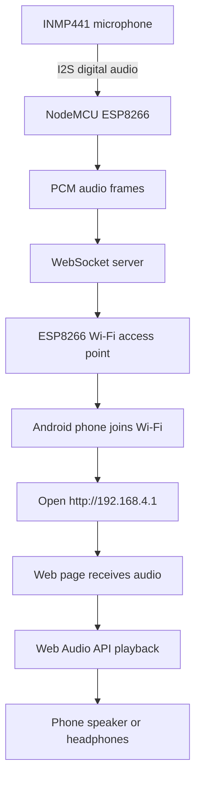
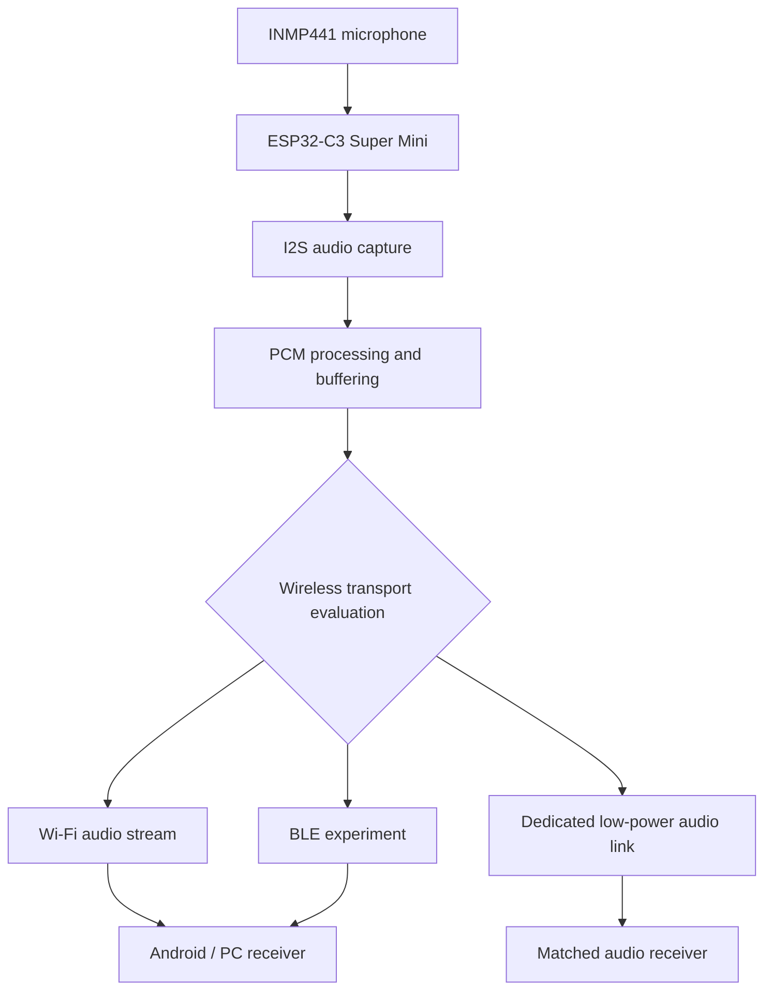
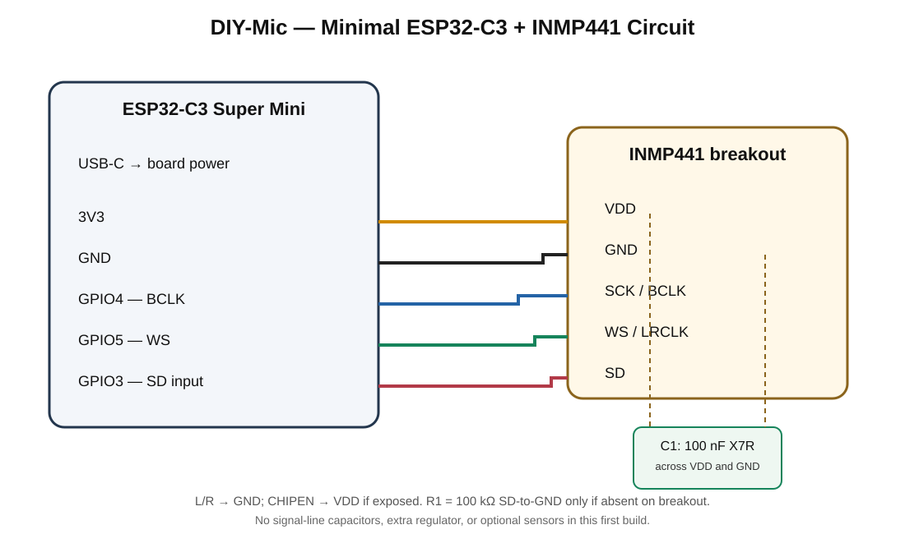
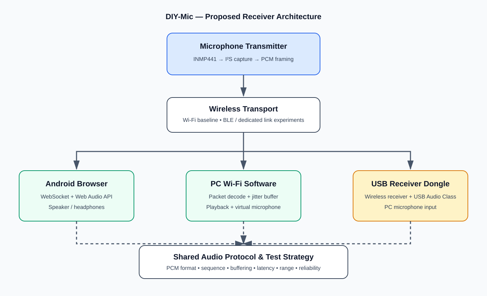

# DIY-Mic

**DIY-Mic** is an evolving DIY wireless microphone project. The goal is to build a small, practical microphone that can be assembled and tested with low-cost, readily available electronics, then refined into a compact portable design.

## Project Vision

Build the microphone in stages:

1. Prove live audio capture and wireless listening.
2. Improve sound quality, latency, reliability, and range.
3. Move from the current ESP8266 prototype to an ESP32-C3 Super Mini.
4. Build a tiny prototype on zero PCB (perfboard), with a compact custom PCB as a later option.
5. Evaluate Wi-Fi, Bluetooth Low Energy (BLE), and dedicated low-power wireless/audio approaches.
6. Develop a small, self-contained microphone system with a practical receiver.

The project is intentionally iterative. Hardware, firmware, receiver software, measurements, and decisions will be documented as development continues.

## Active Development Track — ESP32-S3 BLE Bring-up

A separate ESP32-S3 N16R8 + INMP441 track is documented under [ESP32-S3/](ESP32-S3/). Reported chip details are ESP32-S3 QFN56 revision v0.2, 16 MB flash, 8 MB embedded PSRAM (AP_3v3), and a 40 MHz crystal. The exact carrier-board model is not yet identified. INMP441 GPIO4/5/6 remains provisional. BLE discovery, connection, GATT discovery, and Status read are recorded; Control PING/PONG and Audio notifications remain pending. The 2026-11-09 INMP441 I²S diagnostic passed driver initialization but did not establish stable valid PCM: zero-data windows, intermittent raw data, and clipping warnings remain under investigation. See the [I²S test report](ESP32-S3/docs/I2S_TEST_REPORT.md), [board/GPIO record](ESP32-S3/docs/HARDWARE_CONFIGURATION.md) and [command reference](ESP32-S3/docs/COMMAND_REFERENCE.md). This track does not replace or modify the historical ESP8266 and ESP32-C3 implementations.

## Architecture Diagram



## Current Working Prototype — ESP8266 + Wi-Fi

**Current milestone:** V0.5 — Android live playback reported working by the project owner.

### Current hardware

- NodeMCU ESP8266
- INMP441 I²S MEMS microphone

### How the current wireless listening works

The ESP8266 creates its own Wi-Fi access point. The phone joins that network and opens a local webpage hosted by the ESP8266. The webpage connects to the ESP8266 WebSocket server and plays received PCM audio through the browser's Web Audio API.



- Receiver webpage: `http://192.168.4.1`
- WebSocket server: port `81`
- Internet/router: not required for this direct local connection.

### Current test snapshot

| Parameter | Owner-reported result |
|---|---|
| Voice clarity | Clear |
| Background noise | Medium |
| Delay | Low (subjective; not measured) |
| Stability | Stable |
| Distance | 2 m tested |

These are prototype observations, not laboratory measurements. See [Test Results](docs/TEST_RESULTS.md).

## Future Hardware — ESP32-C3 Super Mini

The next planned prototype uses an **ESP32-C3 Super Mini** with the INMP441 microphone. We plan to assemble an initial small prototype on zero PCB/perfboard and validate the wiring, power, I²S capture, and wireless stream before making the design smaller.



The first ESP32-C3 version will retain Wi-Fi streaming as the baseline because it is closest to the working prototype. BLE and other low-power options are research items, not confirmed replacements.

## Minimal ESP32-C3 Prototype

The next hardware build is intentionally small: **ESP32-C3 Super Mini + INMP441 + the microphone's required local 100 nF decoupling (add it only if the breakout does not already have it)**. No display, sensor array, buttons, GPIO expander, or battery charger is included in the first circuit. The target is a roughly 20 mm-class zero-PCB assembly, subject to the actual module dimensions and USB/antenna clearance.



- [Minimal circuit, component list, power/noise guidance and expansion plan](docs/ESP32-C3-MINI-CIRCUIT.md)
- [ESP32-C3 GPIO allocation and migration checklist](docs/ESP32-C3-MIGRATION.md)
- [Hardware and wiring reference](docs/HARDWARE.md)

The first build uses USB-C power, the Super Mini's 3.3 V rail, INMP441 I²S on GPIO3/4/5, and short wiring. Future peripherals remain optional add-ons; do not populate them on the tiny first revision.

## Wireless Technology Strategy

| Technology | Intended evaluation | Important consideration |
|---|---|---|
| Wi-Fi + local webpage/WebSocket | Keep as the working baseline | Convenient browser receiver; power use and latency need measurement |
| Bluetooth Low Energy (BLE) | Evaluate control, setup, and experimental audio transport | ESP32-C3 supports BLE, not Bluetooth Classic; continuous audio throughput and phone compatibility must be proven |
| Dedicated low-power audio link/module | Explore for a small microphone-to-receiver product | Requires a matched receiver and careful module/protocol selection |
| Other Bluetooth audio-capable hardware | Consider only if standard Bluetooth audio profiles become a requirement | May require a different MCU/module and receiver architecture |

**Important:** ESP32-C3 does not support Bluetooth Classic. Do not assume it can directly provide a conventional Bluetooth headset/A2DP microphone experience. BLE data transfer is not automatically a standard Bluetooth audio solution. See the [ESP32-C3 Migration Plan](docs/ESP32-C3-MIGRATION.md).

## Receiver Architecture and Options

The receiver strategy evaluates three PC paths: browser-based Wi-Fi playback, native Wi-Fi receiver software with OS virtual microphone integration, and an optional dedicated USB Audio Class receiver dongle. Android browser playback remains the current owner-reported baseline.



See **[Receiver Options and Architecture](docs/RECEIVER-OPTIONS-AND-ARCHITECTURE.md)** for the receiver comparison, decoding options, wireless transport, power choices, and proposed future structure.

## Development Environment

The current documented development setup is Ubuntu + VS Code + PlatformIO. It records the ESP8266 PlatformIO versions, serial-port checks, build/upload/monitor commands, and hardware notes.

See [Development Setup](docs/DEVELOPMENT-SETUP.md). VS Code build, upload, serial-monitor, and Python-test tasks are available through **Terminal → Run Task**.

## Tests and Bring-up Code

The repository now contains:

- An ESP8266 PlatformIO serial bring-up project to check the build/upload/serial workflow. It is not the live microphone firmware.
- A Python raw PCM inspection utility for signed 16-bit little-endian mono PCM.
- Unit tests for PCM decoding and basic audio metrics.

Run the host-side tests from the repository root:

```bash
python3 -m unittest discover -s tests -p 'test_*.py' -v
```

See [Tests and Diagnostics](tests/README.md) and [ESP8266 Serial Bring-up](firmware/esp8266/serial-bringup/README.md).

## Project Command Library

All project terminal commands are organized under [commands/](commands/). The guides separate Ubuntu shell commands from commands entered inside `bluetoothctl`, explain each command's purpose and use case, and link to the terminal log archive. Start with [Command Library](commands/README.md).

## Current Repository Structure

```text
DIY-Mic/
├── commands/
│   ├── README.md
│   ├── ESP32-S3.md
│   ├── ESP32-C3.md
│   ├── ESP8266.md
│   ├── GIT.md
│   ├── HOST-TESTS.md
│   └── logs/
├── ESP32-S3/
│   ├── README.md
│   ├── AGENTS.md
│   ├── docs/
│   └── tests/
├── .gitignore
├── .vscode/
│   ├── extensions.json
│   └── tasks.json
├── README.md
├── LICENSE
├── docs/
│   ├── ARCHITECTURE.md
│   ├── DEVELOPMENT-SETUP.md
│   ├── ESP32-C3-MIGRATION.md
│   ├── EXPERIMENT_LOG.md
│   ├── HARDWARE.md
│   ├── PRODUCT-VISION.md
│   ├── PROJECT_STATUS.md
│   ├── RECEIVER-OPTIONS-AND-ARCHITECTURE.md
│   ├── ROADMAP.md
│   └── TEST_RESULTS.md
├── firmware/
│   └── esp8266/
│       └── serial-bringup/
│           ├── platformio.ini
│           ├── README.md
│           └── src/
│               └── main.cpp
├── hardware/
│   └── diagrams/
│       ├── esp32-c3-supermini-inmp441-wiring.png
│       ├── esp8266-inmp441-wiring.png
│       ├── receiver-architecture.svg
│       └── system-architecture.png
└── tests/
    ├── README.md
    ├── test_pcm_inspect.py
    └── tools/
        └── pcm_inspect.py
```

The ESP32-S3 BLE bring-up track is maintained separately in the root-level `ESP32-S3/` directory. Existing ESP8266 and ESP32-C3 implementation folders remain preserved. Planned receiver, USB dongle, PCB, and additional hardware test folders will be added when they contain actual implementation files.

## Development Roadmap

- **V0.5:** ESP8266 + INMP441 Wi-Fi audio prototype — owner-reported working.
- **V0.6:** Diagnose background noise and verify audio sample format.
- **V0.7:** Improve buffering, packet handling, and measure latency.
- **V0.8:** Build an Ubuntu receiver and PipeWire virtual microphone.
- **V0.9:** Measure range, power consumption, and battery runtime.
- **V1.0:** Complete and document the ESP8266 prototype.
- **V1.1:** Assemble ESP32-C3 Super Mini + INMP441 on zero PCB.
- **V1.2:** Port and validate Wi-Fi audio streaming on ESP32-C3.
- **V1.3:** Evaluate BLE and dedicated low-power wireless/audio options.
- **V1.4:** Design a smaller, reliable power and microphone assembly.
- **V2.0:** Select the best validated wireless architecture and publish a compact DIY microphone build.

See [Roadmap](docs/ROADMAP.md), [System Architecture](docs/ARCHITECTURE.md), and [Product Vision](docs/PRODUCT-VISION.md).

## Development Principle

We will update this repository whenever a meaningful experiment, code change, measurement, hardware revision, or technical decision is completed. Planned work will remain clearly labelled as planned until it is implemented and verified.

## License

See [LICENSE](LICENSE).
