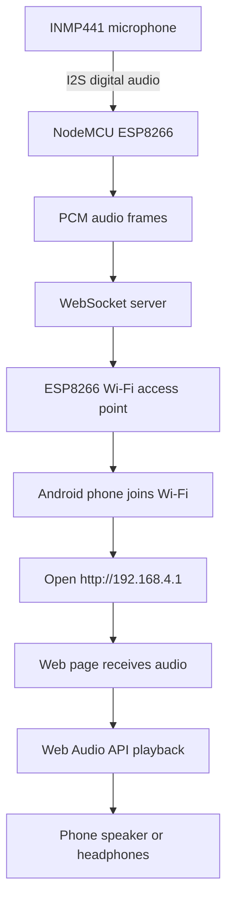
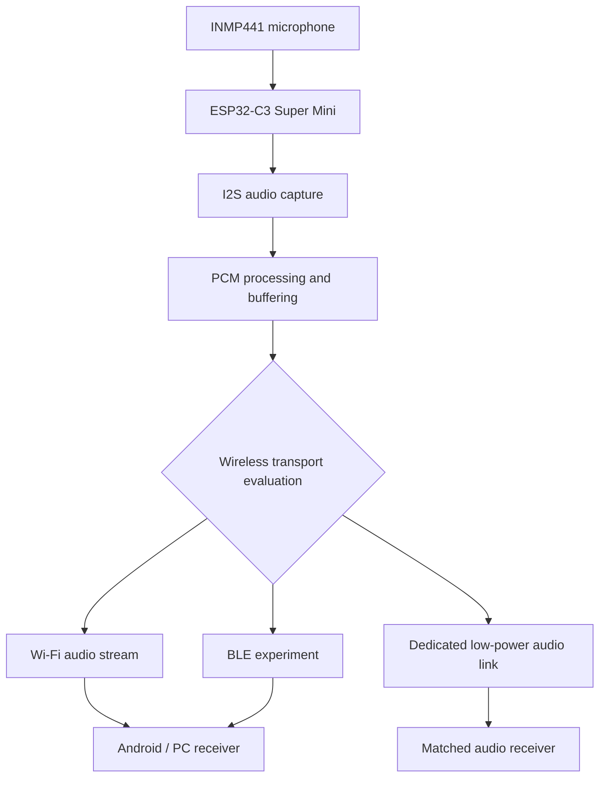

# DIY-Mic

**DIY-Mic** is an evolving DIY wireless microphone project. The goal is to build a small, practical microphone that can be assembled and tested with low-cost, readily available electronics, then refined into a compact portable design.

## Project Vision

Build the microphone in stages:

1. Prove live audio capture and wireless listening.
2. Improve sound quality, latency, reliability, and range.
3. Move from the current ESP8266 prototype to an ESP32-C3 Super Mini.
4. Build a tiny prototype on zero PCB (perfboard), with a compact custom PCB as a later option.
5. Evaluate Wi-Fi, Bluetooth Low Energy (BLE), and dedicated low-power wireless/audio approaches.
6. Develop a small, self-contained microphone system with a practical receiver.

The project is intentionally iterative. Hardware, firmware, receiver software, measurements, and decisions will be documented as development continues.

## Current Working Prototype — ESP8266 + Wi-Fi

**Current milestone:** V0.5 — Android live playback reported working by the project owner.

### Current hardware

- NodeMCU ESP8266
- INMP441 I²S MEMS microphone

### How the current wireless listening works

The ESP8266 creates its own Wi-Fi access point. The phone joins that network and opens a local webpage hosted by the ESP8266. The webpage connects to the ESP8266 WebSocket server and plays received PCM audio through the browser's Web Audio API.

- Receiver webpage: `http://192.168.4.1`
- WebSocket server: port `81`
- Internet/router: not required for this direct local connection.

### Current test snapshot

| Parameter | Owner-reported result |
|---|---|
| Voice clarity | Clear |
| Background noise | Medium |
| Delay | Low (subjective; not measured) |
| Stability | Stable |
| Distance | 2 m tested |

These are prototype observations, not laboratory measurements. See [Test Results](docs/TEST_RESULTS.md).

## Future Hardware — ESP32-C3 Super Mini

The next planned prototype uses an **ESP32-C3 Super Mini** with the INMP441 microphone. We plan to assemble an initial small prototype on zero PCB/perfboard and validate the wiring, power, I²S capture, and wireless stream before making the design smaller.

The first ESP32-C3 version will retain Wi-Fi streaming as the baseline because it is closest to the working prototype. BLE and other low-power options are research items, not confirmed replacements.

## Wireless Technology Strategy

| Technology | Intended evaluation | Important consideration |
|---|---|---|
| Wi-Fi + local webpage/WebSocket | Keep as the working baseline | Convenient browser receiver; power use and latency need measurement |
| Bluetooth Low Energy (BLE) | Evaluate control, setup, and experimental audio transport | ESP32-C3 supports BLE, not Bluetooth Classic; continuous audio throughput and phone compatibility must be proven |
| Dedicated low-power audio link/module | Explore for a small microphone-to-receiver product | Requires a matched receiver and careful module/protocol selection |
| Other Bluetooth audio-capable hardware | Consider only if standard Bluetooth audio profiles become a requirement | May require a different MCU/module and receiver architecture |

**Important:** ESP32-C3 does not support Bluetooth Classic. Do not assume it can directly provide a conventional Bluetooth headset/A2DP microphone experience. BLE data transfer is not automatically a standard Bluetooth audio solution. See the [ESP32-C3 Migration Plan](docs/ESP32-C3-MIGRATION.md).

## Development Roadmap

- **V0.5:** ESP8266 + INMP441 Wi-Fi audio prototype — owner-reported working.
- **V0.6:** Diagnose background noise and verify audio sample format.
- **V0.7:** Improve buffering, packet handling, and measure latency.
- **V0.8:** Build an Ubuntu receiver and PipeWire virtual microphone.
- **V0.9:** Measure range, power consumption, and battery runtime.
- **V1.0:** Complete and document the ESP8266 prototype.
- **V1.1:** Assemble ESP32-C3 Super Mini + INMP441 on zero PCB.
- **V1.2:** Port and validate Wi-Fi audio streaming on ESP32-C3.
- **V1.3:** Evaluate BLE and dedicated low-power wireless/audio options.
- **V1.4:** Design a smaller, reliable power and microphone assembly.
- **V2.0:** Select the best validated wireless architecture and publish a compact DIY microphone build.

See [Roadmap](docs/ROADMAP.md), [System Architecture](docs/ARCHITECTURE.md), and [Product Vision](docs/PRODUCT-VISION.md).

## Repository Contents

- `docs/` — architecture, hardware, experiments, test results, and future plans.
- `firmware/` — planned location for verified microcontroller firmware.
- `receiver/` — planned location for Android-web and desktop receiver code.
- `hardware/` — planned location for wiring, zero-PCB build notes, and later PCB files.

The exact owner-tested V0.5 firmware and receiver source still need to be imported and reviewed. No placeholder implementation is presented as tested firmware.

## Development Principle

We will update this repository whenever a meaningful experiment, code change, measurement, hardware revision, or technical decision is completed. Planned work will remain clearly labelled as planned until it is implemented and verified.

## License

See [LICENSE](LICENSE).
