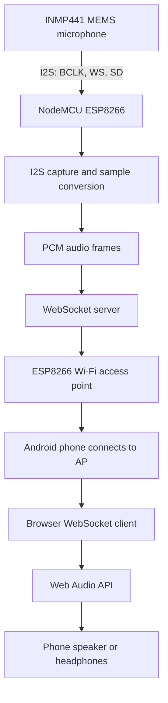
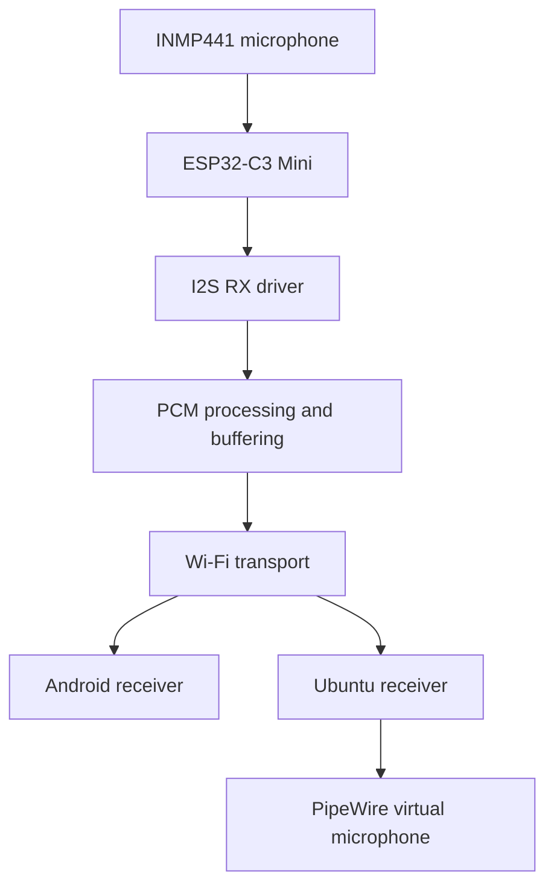

# System Architecture

## Current Prototype — ESP8266

The current prototype uses the NodeMCU ESP8266 and INMP441 digital MEMS microphone. The ESP8266 creates a Wi-Fi access point and sends PCM audio to an Android browser over WebSocket.

### Network Endpoints

| Service | Address |
|---|---|
| HTTP receiver page | `http://192.168.4.1` |
| WebSocket server | Port `81` |
| Default ESP8266 SoftAP address | `192.168.4.1` |

The phone connects directly to the ESP8266 access point. Internet access is not required for this local prototype.

## Audio Data Path

1. INMP441 outputs digital audio over I²S.
2. ESP8266 captures I²S data.
3. Firmware selects and converts the microphone samples into PCM.
4. Firmware groups samples into audio frames.
5. Frames are transmitted through WebSocket over Wi-Fi.
6. The Android browser receives frames and schedules playback through the Web Audio API.

Sample format, frame size, sample rate, and buffering must be kept consistent between sender and receiver. The exact V0.5 firmware source still needs to be added and reviewed before these implementation details can be treated as source-verified.

## Future Platform — ESP32-C3 Mini

The intended hardware evolution is:

The application-level data format and receiver protocol should remain as consistent as practical. The I²S driver, pin mapping, Wi-Fi setup, memory handling, and build configuration will be platform-specific.

## Design Boundaries

Keep these responsibilities separate as the firmware grows:

- **Audio capture:** I²S configuration and microphone sample reading.
- **Audio processing:** channel selection, sample conversion, gain, and optional filtering.
- **Transport:** Wi-Fi access point/client mode and WebSocket packet delivery.
- **Receiver:** browser or desktop playback and buffering.

This separation will make it easier to move from ESP8266 to ESP32-C3 without assuming that low-level peripheral code is portable.
