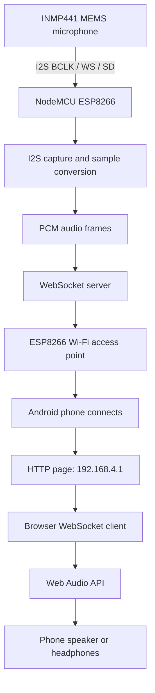
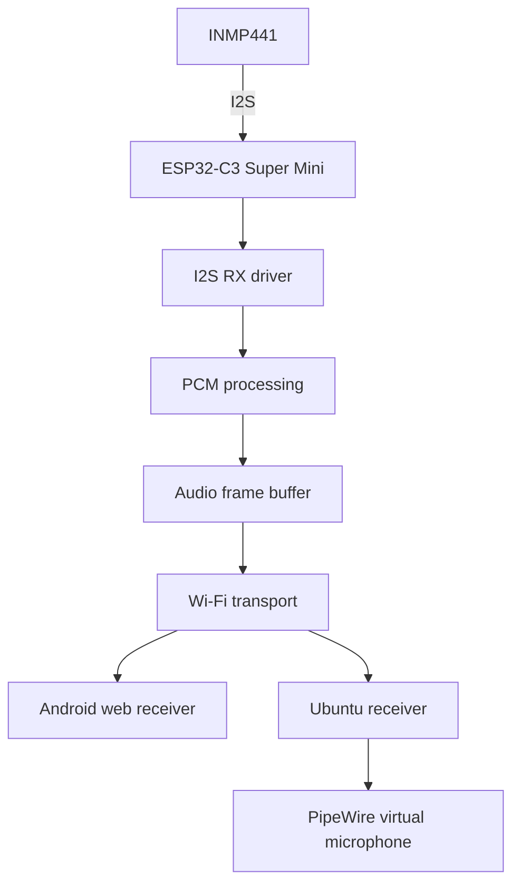
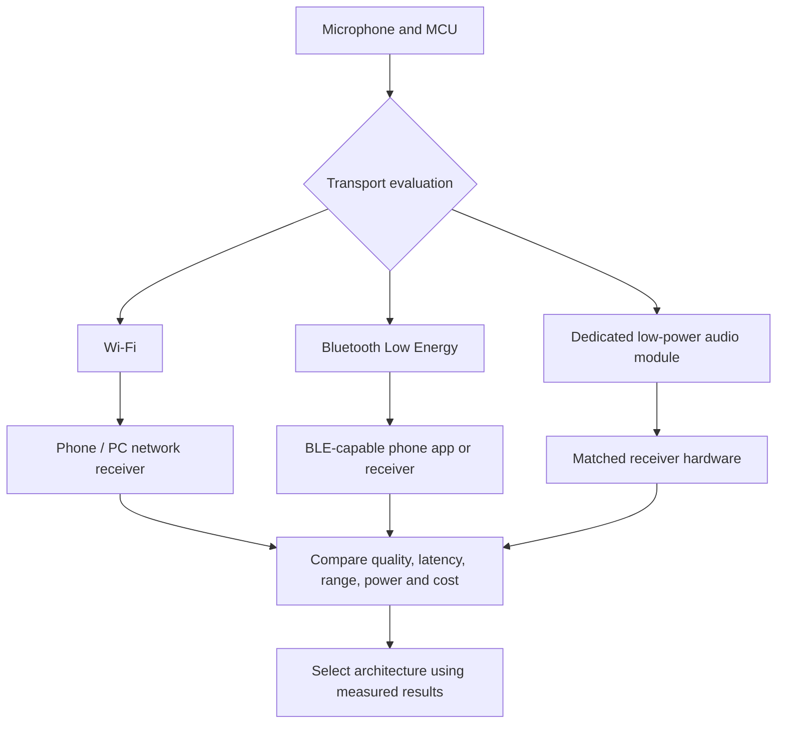
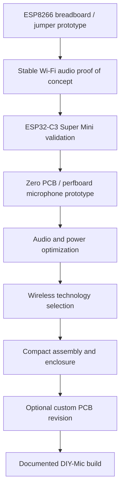

# System Architecture

## 1. Current Prototype: ESP8266 Wi-Fi Audio

The current prototype uses a NodeMCU ESP8266 and an INMP441 I²S MEMS microphone. The ESP8266 creates a local Wi-Fi access point. An Android phone connects to it and listens through a webpage served by the ESP8266.

### Current connection details

- HTTP receiver page: `http://192.168.4.1`
- WebSocket server: port `81`
- Phone joins the ESP8266 access point directly.
- No external Wi-Fi router or internet connection is needed.

### Current audio path

1. INMP441 outputs digital audio over I²S.
2. ESP8266 captures the I²S data.
3. Firmware converts selected samples into PCM audio.
4. Firmware groups samples into frames.
5. Frames are sent over WebSocket through the local Wi-Fi network.
6. The Android browser receives and plays the audio using Web Audio API.

The exact V0.5 source must be added and reviewed before sample rate, frame format, buffering, and implementation details are treated as source-verified.

## 2. Next Prototype: ESP32-C3 Super Mini

The next hardware milestone is an ESP32-C3 Super Mini connected to the same INMP441 microphone. The first build is planned for zero PCB/perfboard to validate the circuit and firmware before miniaturization.

Keep Wi-Fi as the first ESP32-C3 transport target so the receiver can be reused as much as practical. The I²S driver, GPIO assignments, build target, and platform-specific network code must be ported and validated.

## 3. Wireless Technology Exploration

The project will compare more than one way to send microphone audio. The correct choice depends on audio quality, latency, range, power consumption, receiver compatibility, cost, and hardware size.

### Wi-Fi

Current working approach. A local access point and WebSocket stream provide a simple browser-based receiver. Power consumption and range must be measured.

### Bluetooth Low Energy

ESP32-C3 supports Bluetooth LE, but not Bluetooth Classic. BLE may be useful for setup, control, configuration, and low-rate data. Continuous microphone audio over a custom BLE data service must be prototyped and measured. It is not automatically compatible with standard Bluetooth headset or A2DP audio.

### Dedicated low-power audio link

A separate low-power transmitter/receiver pair may be evaluated if Wi-Fi power use is too high or a small standalone microphone-to-receiver system is required. The selected module must be checked for audio bandwidth, latency, codec, range, power, antenna, and receiver availability.

## 4. Minimal First Hardware Revision

The first ESP32-C3 assembly is deliberately limited to the MCU board and one INMP441 digital microphone. USB-C powers the Super Mini during development; its 3.3 V rail powers the microphone. Add one 100 nF X7R capacitor directly across the microphone supply pins. Fit a 100 kΩ SD pull-down only if the microphone breakout does not already contain it.

No display, buttons, sensors, I²C expander, external ADC, battery charger, or extra regulator belongs on this first build. Future peripherals are separate optional modules and must not increase the initial circuit complexity.

The proposed compact target is approximately 20 mm class, but actual fit depends on the Super Mini and microphone breakout dimensions. Keep USB access, antenna clearance, microphone acoustic access, and safe solder spacing. See [Minimal Circuit and BOM](ESP32-C3-MINI-CIRCUIT.md) and [wiring diagram](../hardware/diagrams/esp32-c3-minimal-mic.svg).

## 5. Product Build Stages

Zero PCB/perfboard is the planned first compact prototype platform. A custom PCB is a later improvement, not a prerequisite for the first ESP32-C3 build.

## 6. Design Boundaries

Keep these responsibilities separate:

- Audio capture: I²S setup and microphone sample reading.
- Audio processing: channel selection, sample conversion, gain, and optional filtering.
- Transport: Wi-Fi, BLE, or a dedicated wireless module.
- Receiver: browser, desktop application, or matched receiver hardware.
- Power: regulation, battery charging/protection, runtime measurement, and power modes.

This separation allows the microphone and receiver software to evolve without coupling all features to one wireless protocol.
