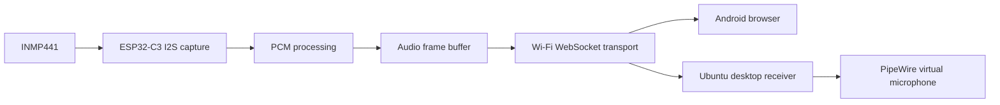

# ESP32-C3 Mini Migration Plan

## Purpose

The current proof of concept uses a NodeMCU ESP8266. The planned next hardware revision will use an ESP32-C3 Mini board while retaining the INMP441 microphone and the Wi-Fi audio receiver concept.

This is a planned migration, not a completed port.

## Why Move to ESP32-C3?

The ESP32-C3 provides a newer platform for continued firmware development. Espressif documents an I²S peripheral on ESP32-C3 and provides an I²S driver in ESP-IDF. The ESP8266 also has I²S input/output, so the migration is not required simply to make I²S possible.

Potential benefits to evaluate:

- A maintained ESP32 software ecosystem and I²S driver.
- More flexible future firmware structure and debugging.
- Bluetooth Low Energy availability on ESP32-C3 hardware, if a future feature needs BLE control or provisioning. BLE should not be assumed to replace the current Wi-Fi audio transport.
- A fresh hardware design with verified power, antenna, and GPIO routing.

The ESP32-C3 is not a drop-in replacement for the ESP8266. The I²S implementation, peripheral driver, GPIO assignment, build target, and network code need to be ported and tested.

## Migration Work Plan

| Stage | Work | Exit condition |
|---|---|---|
| 1 | Select exact ESP32-C3 Mini board/module | Exact board, flash size, antenna and pinout documented |
| 2 | Confirm power and microphone wiring | 3.3 V supply and I²S electrical connections verified |
| 3 | Build I²S-only test firmware | Stable microphone samples captured and inspected |
| 4 | Verify PCM format | Channel, bit alignment, sample rate and amplitude confirmed |
| 5 | Port Wi-Fi access point and WebSocket | Phone receives valid audio frames |
| 6 | Reuse or adapt Android receiver | Live playback verified on the new board |
| 7 | Compare both platforms | Latency, noise, range, stability and current measured |
| 8 | Select production platform | Decision recorded using measured results |

## Important Compatibility Checks

Before wiring or porting, confirm the exact ESP32-C3 Mini board variant and its pinout. Different boards can expose different GPIOs and have different USB, flash, antenna, and boot-strapping arrangements.

The ESP32-C3 has one I²S peripheral. Use the ESP-IDF I²S driver or the corresponding supported Arduino-ESP32 API for the selected framework version. Do not copy ESP8266 low-level I²S calls directly into the ESP32-C3 firmware.

The INMP441 remains a 3.3 V digital I²S microphone. Recheck the selected board's supply capability, GPIO availability, and signal routing before connecting it.

## Target Architecture

## Platform Comparison

| Area | Current ESP8266 | Planned ESP32-C3 |
|---|---|---|
| Current project status | V0.5 Android playback owner-reported working | Not started |
| I²S | Hardware I²S input/output | Hardware I²S peripheral |
| Wi-Fi audio transport | Current prototype | To be ported and measured |
| Firmware API | ESP8266 Arduino core | ESP-IDF or Arduino-ESP32 |
| GPIO mapping | Existing NodeMCU wiring | Must be selected for exact board |
| Bluetooth | Not available | BLE capability; not a substitute for Wi-Fi audio without a separate design |
| Validation | Basic owner-reported prototype tests | No tests yet |

## Migration Acceptance Criteria

Do not mark the ESP32-C3 port complete until:

- Microphone capture is stable.
- Channel selection and sample alignment are verified.
- PCM sample rate and format match the receiver.
- Android playback works continuously.
- Packet loss, jitter, latency, and range are measured.
- Current consumption is measured.
- At least one sustained streaming test is completed.
