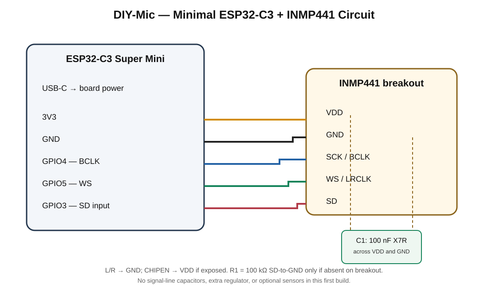

# ESP32-C3 Minimal Microphone Circuit

## Design goal

Build the smallest practical ESP32-C3 + INMP441 wireless microphone prototype. The first hardware revision is intentionally limited to the MCU board, one digital microphone, short I²S wiring, and the microphone's required local decoupling. Do not populate optional sensors, buttons, displays, expanders, or battery circuitry in this revision.

The target is a roughly 20 mm-class zero-PCB assembly where practical. The ESP32-C3 Super Mini and the microphone breakout dimensions may require a slightly larger board. Measure the actual modules and allow room for USB access, antenna clearance, solder joints, and microphone acoustic access before cutting the perfboard.

## Minimal component list (first build)

| Ref | Component | Qty | Requirement |
|---|---|---:|---|
| U1 | ESP32-C3 Super Mini | 1 | Common 16-pad Super Mini layout; verify exact revision |
| MIC1 | INMP441 I²S microphone breakout | 1 | 3.3 V compatible; confirm breakout pin labels |
| C1 | 100 nF ceramic capacitor, X7R or better | 1 | Place directly between microphone VDD and GND |
| R1 | 100 kΩ resistor | 1 | SD-to-GND pull-down, only if not already fitted on the microphone breakout |
| — | Short insulated wire / 2.54 mm headers as needed | — | Keep I²S and power connections short |

**Optional, not fitted by default:** C2 = 4.7–10 µF ceramic capacitor across the local 3.3 V and GND rails near the microphone. Add only if supply measurements or A/B audio captures show a benefit and the Super Mini's existing regulator/output capacitance is insufficient. Do not add a ferrite bead, series resistor, RC network, or LC filter by default.

## Minimal circuit diagram

### Point-to-point wiring

| ESP32-C3 Super Mini | INMP441 breakout | Purpose |
|---|---|---|
| 3V3 | VDD | Microphone supply; never 5 V |
| GND | GND | Common ground |
| GPIO4 | SCK / BCLK | I²S bit clock |
| GPIO5 | WS / LRCLK | I²S word select |
| GPIO3 | SD | I²S microphone data into ESP32-C3 |
| GND | L/R | Select left I²S channel |

If the breakout exposes CHIPEN, tie it to VDD for always-on operation. If the breakout already handles CHIPEN, do not add another wire. Connect C1 as close as possible to the microphone VDD/GND pins. Fit R1 from SD to GND only if the breakout does not already include the datasheet-recommended pull-down.

## Power and noise-reduction approach

1. Power the Super Mini through its USB-C connector during development. Use its regulated 3.3 V output for the INMP441 only after confirming the exact board's regulator and 3V3 rail.
2. Place C1 (100 nF X7R) directly at the microphone supply pins. This is the microphone manufacturer's specified local bypass capacitor.
3. Keep BCLK, WS, SD, 3V3, and GND wires short. Keep the microphone away from the ESP32 antenna edge, USB cable, switching converters, and high-current wiring where practical.
4. Use a short, low-impedance common ground. Do not route microphone ground through a noisy load.
5. Do not put capacitors or RC low-pass filters on BCLK, WS, or SD. These are digital I²S signals; loading or slowing them can corrupt data.
6. Do not add a separate regulator or ferrite/LC power filter in the first build. First compare the microphone on the board's 3.3 V rail with a known-good USB supply and inspect the 3.3 V rail for ripple or dips.
7. If measured supply noise remains, test C2 (4.7–10 µF) in parallel with C1 at the microphone. Add ferrite isolation or a separate low-noise regulator only after measurements demonstrate a need and the voltage-drop/transient response is checked.

The INMP441 is a digital-output microphone with internal signal conditioning and digital filtering. External analog audio filtering is not required between its output and the ESP32-C3. Diagnose persistent hiss with silence/speech PCM captures, correct I²S slot selection, sample alignment, grounding, and supply measurements rather than adding arbitrary filters.

## ESP32-C3 Super Mini GPIO allocation

This is the selected project mapping for the common Super Mini header layout. It is a proposed firmware pin assignment, not yet physically validated on the user's board.

| GPIO | Initial build | Future reservation / notes |
|---:|---|---|
| 0 | — | I²C SDA for future expansion |
| 1 | — | I²C SCL for future expansion |
| 2 | Keep clear | Strapping pin |
| 3 | INMP441 SD | Also has boot-mode sampling considerations; microphone data output is high-impedance outside its active slot; verify cold boot with mic connected |
| 4 | INMP441 BCLK | JTAG function conflict; external JTAG not used in this build |
| 5 | INMP441 WS | JTAG function conflict; ADC2 is constrained while Wi-Fi is active |
| 6 | — | Future UART1 / peripheral GPIO; JTAG function |
| 7 | — | Future UART1 / peripheral GPIO; JTAG function |
| 8 | Keep clear | Strapping pin; commonly onboard LED |
| 9 | Keep clear | Strapping pin; commonly BOOT button |
| 10 | — | Future general GPIO |
| 11 | Keep clear | VDD_SPI / flash supply function |
| 12–17 | Keep clear | SPI flash interface / not recommended for general use |
| 18–19 | USB | Native USB D-/D+; preserve for USB programming/debug |
| 20 | UART0 RX | UART debugging |
| 21 | UART0 TX | UART debugging |

**Debugging:** USB is the primary development/programming connection. UART0 logging uses GPIO20/GPIO21 if the selected firmware and board routing enable it. Do not assume a USB-to-UART bridge exists on every Super Mini variant. Native USB Serial/JTAG on GPIO18/GPIO19 and UART0 on GPIO20/GPIO21 are separate interfaces at the chip level, but actual board routing and firmware console configuration must be checked.

### Future expansion only

Do not populate these parts on the minimal microphone board. Add them as separate modules or a later expansion board when required.

| Existing peripheral | Low-complexity future approach |
|---|---|
| Four push buttons | MCP23017 I²C GPIO expander, or a small direct-GPIO daughterboard if pins remain available |
| PIR | Direct GPIO if available; expander only for simple level/status output |
| IR receiver | Direct GPIO preferred for accurate pulse timing; expander only after timing tests |
| DHT11 | Direct GPIO; avoid slow I²C GPIO expander |
| GPS | UART1 on a later selected GPIO pair |
| MQ analog output | External ADC; scale/condition output so it never exceeds ADC input limits |
| MQ digital output | Direct GPIO or expander |
| LDR divider | MCU ADC or external ADC, with divider sized for the ADC range |
| Ultrasonic | Prefer a compact I²C module; HC-SR04 needs direct timing-sensitive trigger/echo GPIO and Echo level shifting |
| OLED | Not included; user selected no display |

A single I²C bus on GPIO0/GPIO1 can host compatible future expanders/ADCs, but the initial board should leave those pins unconnected. Do not attempt to attach every sensor to the tiny microphone board.

## Bring-up checklist

- Verify the exact Super Mini revision and header labels before wiring.
- Check the INMP441 breakout labels and whether it already contains C1/R1/CHIPEN support.
- Confirm 3.3 V at the microphone supply; never connect the mic to 5 V.
- Test USB programming and serial logging before connecting the microphone.
- Test I²S capture on GPIO3/GPIO4/GPIO5 and verify the selected left channel.
- Capture 10 seconds of silence and 10 seconds of speech at a fixed microphone distance.
- Inspect RMS, peak, DC offset, and clipping; compare the 3.3 V supply under idle and Wi-Fi transmit.
- Run Wi-Fi streaming only after raw I²S capture is stable.
- Record actual dimensions and current consumption before claiming the 20 mm target or battery runtime.

## References

- [TDK InvenSense INMP441 datasheet](https://invensense.tdk.com/wp-content/uploads/2015/02/INMP441.pdf)
- [Espressif ESP32-C3 datasheet](https://documentation.espressif.com/esp32-c3_datasheet_en.html)
- [ESP32-C3 Super Mini board pin mapping reference](https://nuttx.apache.org/docs/latest/platforms/risc-v/esp32c3/boards/esp32c3-supermini/index.html)
