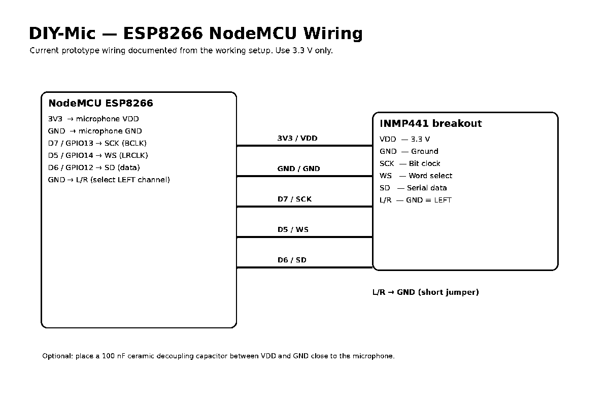
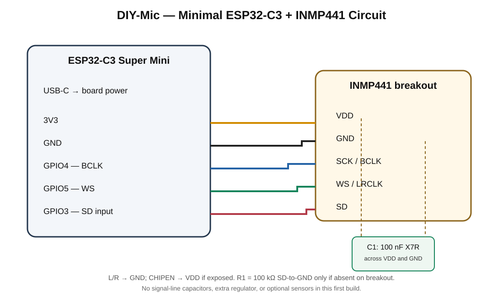

# Hardware and Wiring

## Current Prototype: NodeMCU ESP8266 + INMP441

| INMP441 pin | NodeMCU pin | ESP8266 GPIO |
|---|---|---:|
| VDD | 3V3 | 3.3 V |
| GND | GND | GND |
| SCK / BCLK | D7 | GPIO13 |
| WS / LRCLK | D5 | GPIO14 |
| SD | D6 | GPIO12 |
| L/R | GND | Left channel |

Supply the INMP441 from 3.3 V, never 5 V. The exact current V0.5 wiring remains the reference until the ESP32-C3 migration is tested.

## Next Prototype: Minimal ESP32-C3 Super Mini + INMP441

The first ESP32-C3 revision is intentionally minimal. Populate only:

- ESP32-C3 Super Mini
- INMP441 microphone breakout
- C1: ensure 100 nF X7R local decoupling across microphone VDD/GND; add only if absent on the breakout
- R1: 100 kΩ from SD to GND only if not already present on the breakout
- Short wiring; USB-C powers the board during development

Do not populate displays, buttons, sensors, I²C expanders, external ADCs, battery/charger circuitry, or an extra regulator in this revision.

| INMP441 pin | ESP32-C3 Super Mini | Purpose |
|---|---|---|
| VDD | 3V3 | 3.3 V microphone supply |
| GND | GND | Common ground |
| SCK / BCLK | GPIO4 | I²S bit clock |
| WS / LRCLK | GPIO5 | I²S word select |
| SD | GPIO3 | I²S data input |
| L/R | GND | Left channel |
| CHIPEN (if exposed) | 3V3 | Enable microphone |

Confirm the exact breakout pin labels and board revision before wiring. The target is a roughly 20 mm-class zero-PCB build only if the physical module dimensions, USB access, antenna clearance, and acoustic opening permit it.

## ESP32-C3 Super Mini GPIO Reference

The following mapping is for the common Super Mini header layout. Clone board revisions may differ; verify the physical silkscreen and schematic.

| GPIO | First-build assignment | Future use / restrictions |
|---:|---|---|
| 0 | Unused | I²C SDA |
| 1 | Unused | I²C SCL |
| 2 | Reserved | Strapping pin |
| 3 | INMP441 SD | Check cold boot with microphone attached |
| 4 | INMP441 BCLK | JTAG function; external JTAG not used |
| 5 | INMP441 WS | JTAG function; ADC2 constrained during Wi-Fi |
| 6 | Unused | Future UART1/peripheral GPIO; JTAG function |
| 7 | Unused | Future UART1/peripheral GPIO; JTAG function |
| 8 | Reserved | Strapping pin; often onboard LED |
| 9 | Reserved | Strapping pin; often BOOT button |
| 10 | Unused | Future GPIO |
| 11 | Reserved | VDD_SPI / flash supply function |
| 12–17 | Reserved | SPI flash interface; do not use as general GPIO |
| 18 | USB D- | Native USB; preserve |
| 19 | USB D+ | Native USB; preserve |
| 20 | UART0 RX | UART debug |
| 21 | UART0 TX | UART debug |

USB Serial/JTAG uses GPIO18/GPIO19. UART0 uses GPIO20/GPIO21. These are separate chip interfaces, but whether both are exposed and usable concurrently depends on the exact board routing and firmware console configuration. The Super Mini may not include a separate USB-to-UART bridge.

GPIO2, GPIO8, and GPIO9 are strapping pins. GPIO4–GPIO7 have JTAG functions. GPIO11 and GPIO12–GPIO17 have flash-related restrictions. All ESP32-C3 GPIO signals are 3.3 V logic; never apply 5 V to a GPIO or ADC input.

## Future Peripheral Expansion — Not Part of First Build

| Peripheral | Future connection approach |
|---|---|
| Four push buttons | MCP23017 I²C expander or direct GPIO on a later revision |
| PIR | Direct GPIO preferred |
| IR receiver | Direct GPIO preferred for pulse timing |
| DHT11 | Direct GPIO |
| GPS | UART1 on a later selected GPIO pair |
| MQ analog output | External ADC with safe input scaling |
| MQ digital output | Direct GPIO or expander |
| LDR divider | MCU ADC or external ADC |
| Ultrasonic | Prefer I²C module; HC-SR04 needs two timing-sensitive GPIOs and Echo level shifting |
| OLED | Not included; no display selected |

The first build leaves GPIO0/GPIO1 available for a future I²C expansion bus. Do not add all peripherals to the tiny microphone board; use separate modules or a later expansion board.

## Power and Noise Reduction

- USB-C power is the development baseline.
- Confirm the exact Super Mini board's 3.3 V regulator and output rail before attaching the microphone.
- Fit the 100 nF X7R bypass capacitor directly at the microphone supply pins.
- Optional 4.7–10 µF local bulk capacitance is an experiment only, added if measurements show a supply-noise or transient benefit.
- Do not add an extra regulator, ferrite bead, LC filter, or RC network by default.
- Do not place capacitors on I²S BCLK, WS, or SD.
- Keep I²S and power wiring short and use a common low-impedance ground.
- Measure/capture before and after any filtering change. The INMP441 is digital-output and includes internal signal conditioning; external analog audio filtering is not needed.

See [Minimal Circuit, BOM and Bring-up Checklist](ESP32-C3-MINI-CIRCUIT.md).

## Board and Tooling Notes

- Current reference board: NodeMCU ESP8266 (PlatformIO `nodemcuv2`)
- Planned board: ESP32-C3 Super Mini
- Current framework: Arduino
- Current ESP8266 PlatformIO platform: 4.2.1
- Current ESP8266 Arduino core: 3.1.2

## References

- [INMP441 datasheet (TDK InvenSense)](https://invensense.tdk.com/wp-content/uploads/2015/02/INMP441.pdf)
- [ESP32-C3 series datasheet](https://documentation.espressif.com/esp32-c3_datasheet_en.html)
- [ESP32-C3 Super Mini pin mapping reference](https://nuttx.apache.org/docs/latest/platforms/risc-v/esp32c3/boards/esp32c3-supermini/index.html)
- [ESP32-C3 hardware design guidelines](https://docs.espressif.com/projects/esp-hardware-design-guidelines/en/latest/esp32c3/)
