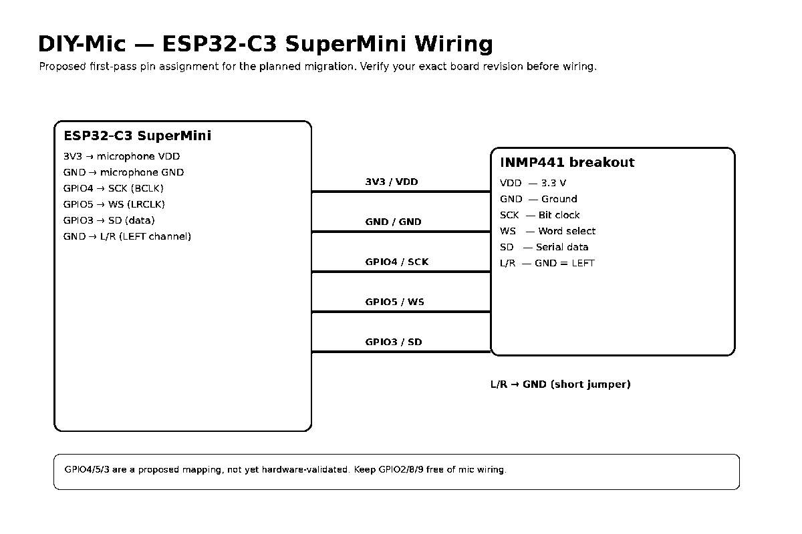

# Hardware and Wiring

## Current Prototype: NodeMCU ESP8266 + INMP441

| INMP441 pin | NodeMCU pin | ESP8266 GPIO |
|---|---|---:|
| VDD | 3V3 | 3.3 V |
| GND | GND | GND |
| SCK / BCLK | D7 | GPIO13 |
| WS / LRCLK | D5 | GPIO14 |
| SD | D6 | GPIO12 |
| L/R | GND | Left channel |

**Power:** Supply the INMP441 from 3.3 V. Never connect VDD to 5 V. Add an optional 100 nF decoupling capacitor close to the microphone.

## Planned Prototype: ESP32-C3 Super Mini + INMP441

The following is a proposed GPIO assignment for the first prototype. It is not yet hardware-validated. Confirm the exact SuperMini board revision and its silkscreen before wiring.

| INMP441 pin | ESP32-C3 SuperMini pin | Purpose |
|---|---|---|
| VDD | 3V3 | 3.3 V supply |
| GND | GND | Common ground |
| SCK / BCLK | GPIO4 | I²S bit clock |
| WS / LRCLK | GPIO5 | I²S word select |
| SD | GPIO3 | I²S data input |
| L/R | GND | Left channel selection |

Avoid using GPIO2, GPIO8, and GPIO9 for this first assignment because they have strapping/board-function considerations on common ESP32-C3 SuperMini variants. GPIO assignments can vary by board vendor and revision.

## ESP32-C3 GPIO Reference

Common ESP32-C3 SuperMini V1.0-style boards expose these pins. Check your exact board; clones may differ.

| GPIO | Typical board label / function | Notes |
|---:|---|---|
| 0 | GPIO0 / ADC | General I/O |
| 1 | GPIO1 / ADC | General I/O |
| 2 | GPIO2 / ADC | Strapping pin; avoid external boot-level forcing |
| 3 | GPIO3 / ADC | Proposed I²S SD |
| 4 | GPIO4 / ADC | Proposed I²S BCLK |
| 5 | GPIO5 / ADC | Proposed I²S WS |
| 6 | GPIO6 | Often exposed; JTAG function also available |
| 7 | GPIO7 | Often exposed; JTAG function also available |
| 8 | GPIO8 | Often onboard LED / strapping function |
| 9 | GPIO9 | BOOT button / strapping function |
| 10 | GPIO10 | General I/O |
| 20 | GPIO20 / RX | UART0 RX |
| 21 | GPIO21 / TX | UART0 TX |
| 18 | USB D- | USB interface |
| 19 | USB D+ | USB interface |

ESP32-C3 GPIOs are 3.3 V logic. Do not apply 5 V to GPIO pins. GPIO18/19 may be committed to native USB on board designs and should not be assumed to be free.

## Data Path

The INMP441 outputs digital audio over I²S. The MCU captures the samples, converts them into PCM, and sends audio frames over the selected wireless transport.

## Board and Tooling Notes

- Current reference board: NodeMCU ESP8266 (PlatformIO `nodemcuv2`)
- Planned board: ESP32-C3 SuperMini
- Current framework: Arduino
- Current ESP8266 PlatformIO platform: 4.2.1
- Current ESP8266 Arduino core: 3.1.2

## References

- [INMP441 datasheet (TDK InvenSense)](https://invensense.tdk.com/wp-content/uploads/2015/02/INMP441.pdf)
- [NodeMCU GPIO mapping](https://nodemcu.readthedocs.io/en/dev/modules/gpio/)
- [ESP32-C3 series datasheet](https://documentation.espressif.com/esp32-c3_datasheet_en.html)
- [ESP32-C3 SuperMini pin mapping reference](https://nuttx.apache.org/docs/latest/platforms/risc-v/esp32c3/boards/esp32c3-supermini/index.html)

Board pin tables are reference guidance, not a substitute for checking the exact physical board revision.
