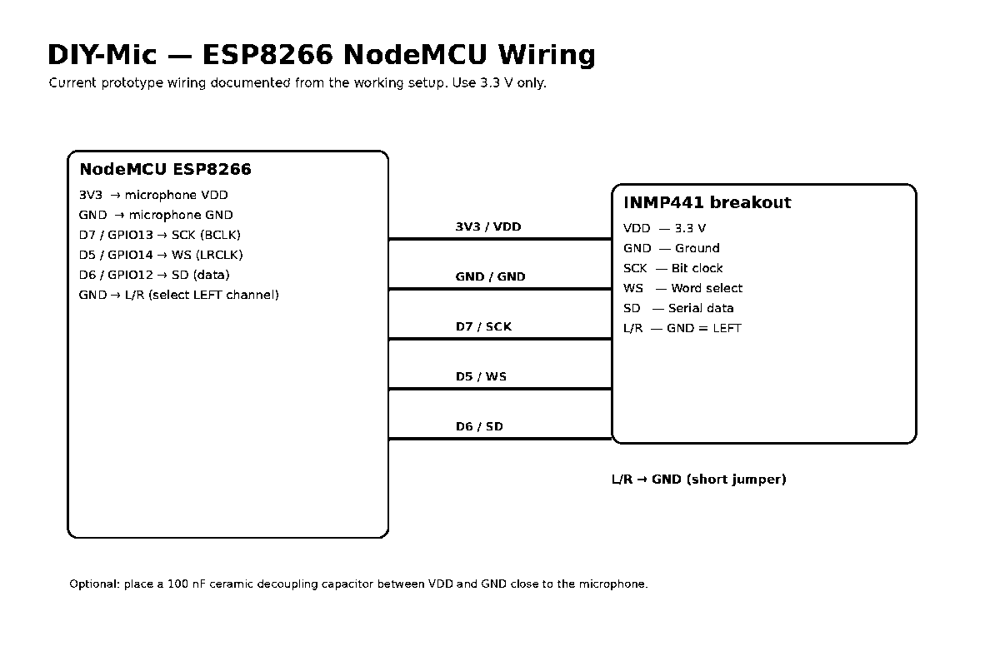
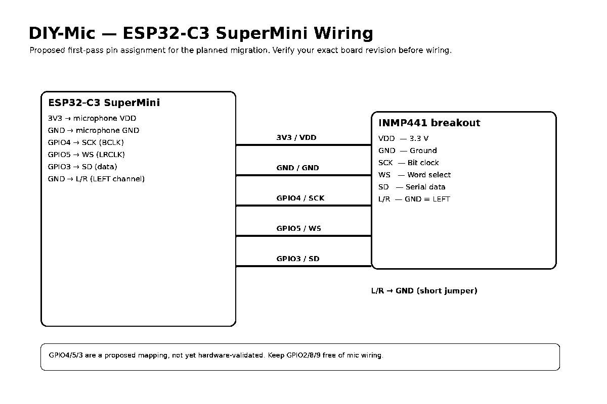
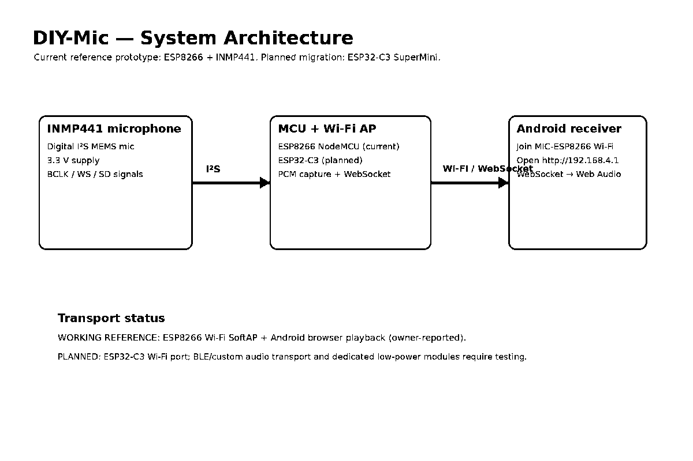
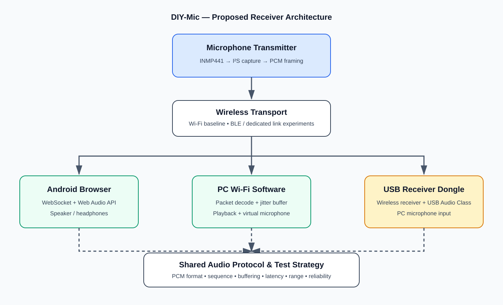

# DIY-Mic Receiver Architecture and Options

> **Document status:** Architecture proposal  
> **Scope:** Android and PC receivers, Wi-Fi/web software, dedicated USB receiver hardware, audio decoding, power-independent receiver design, and future repository structure.  
> **Important:** This document separates the owner-reported working ESP8266 prototype from planned or unverified receiver designs. Performance targets are not measured specifications.

## 1. Purpose

DIY-Mic is intended to become a compact wireless microphone system that can deliver live speech audio to Android phones and computers. The receiver should be usable without requiring the microphone to be connected to an existing internet router.

The receiver architecture should support three product paths:

1. A browser-based receiver for Android and compatible desktop browsers.
2. A native PC receiver application that receives Wi-Fi audio and exposes a system microphone.
3. An optional dedicated USB receiver dongle that appears to the computer as a standard USB microphone.

The long-term product may support both software and USB receivers. The first implementation should remain simple and use the existing Wi-Fi prototype as the reference.

## 2. Current verified/reported baseline

### 2.1 Current prototype

- Microcontroller: NodeMCU ESP8266.
- Microphone: INMP441 I²S MEMS microphone.
- Wireless transport: ESP8266 Wi-Fi access point and WebSocket.
- Receiver: Android browser webpage using the Web Audio API.
- Local webpage: `http://192.168.4.1`.
- WebSocket server: port `81`.
- Internet access or an external router is not required for the direct access-point connection.

The project owner reports that live Android playback works. The latest owner-reported test snapshot is:

| Parameter | Reported result | Evidence status |
|---|---|---|
| Voice clarity | Clear | Subjective owner report |
| Background noise | Medium | Subjective owner report |
| Delay | Low | Not instrument-measured |
| Stability | Stable | Limited prototype test |
| Distance | 2 m | Tested distance; not maximum range |

This baseline does not establish 10–20 m range, sub-100 ms latency, long-duration reliability, PC compatibility, USB receiver compatibility, or battery runtime.

### 2.2 Existing hardware diagrams





The ESP32-C3 wiring image is a proposed mapping and must be checked against the exact board revision before assembly.



## 3. Target system architecture

The transmitter should produce a well-defined audio frame format. Receiver-specific code should handle transport, buffering, decoding, and operating-system audio output separately.



### 3.1 Logical data path

```text
INMP441
   |
I2S capture
   |
Sample conversion / PCM framing
   |
Sequence number + packet metadata
   |
Wireless transport
   |
Receiver transport adapter
   |
Packet validation and ordering
   |
Jitter / playback buffer
   |
PCM decoder or format conversion
   |
Audio output backend
   |
Speaker, headphones, or virtual microphone
```

### 3.2 Separation of responsibilities

| Layer | Responsibility |
|---|---|
| Microphone capture | Read I²S samples from the microphone |
| Audio processing | Convert sample width, scale, and optionally filter |
| Packet framing | Add sequence, format, and timing metadata |
| Transport | Carry audio over Wi-Fi or a future link |
| Receiver transport adapter | Receive bytes and report connection state |
| Packet validation | Check packet size, sequence, and format |
| Buffering | Smooth network jitter and handle late/missing packets |
| PCM output | Supply correctly timed samples to the output backend |
| OS integration | Provide speaker playback or microphone input to applications |

Do not duplicate audio-format handling in each receiver. A common protocol and decoder should be reused wherever practical.

## 4. Receiver option A — Browser-based Wi-Fi receiver

**Priority: First receiver path to maintain and improve.**

### 4.1 Architecture

```text
DIY-Mic access point
        |
      Wi-Fi
        |
Android / PC browser
        |
HTTP page + WebSocket audio
        |
Web Audio API
        |
Speaker / headphones
```

### 4.2 Advantages

- No dedicated receiver hardware.
- Simple installation and distribution.
- Works with the existing ESP8266 local webpage concept.
- Suitable for Android playback and desktop browser playback.
- The microphone can host the receiver webpage locally.
- Useful for early demonstrations and debugging.

### 4.3 Limitations

- Browser autoplay policies may require a user gesture.
- Browser audio scheduling and buffering need careful implementation.
- A browser speaker output is not automatically a system-wide microphone input.
- Browser support and behaviour differ between Android, Linux, and Windows.
- Exposing a browser stream as a virtual microphone may require a separate OS audio-routing component.

### 4.4 Intended use

- Android live monitoring.
- Quick PC playback and diagnostics.
- Initial product demonstration.
- Firmware and transport debugging.

**Status:** Android browser playback is owner-reported working on the ESP8266 prototype. Desktop browser support remains to be tested.

## 5. Receiver option B — Native Wi-Fi receiver software

**Priority: First PC receiver implementation.**

A native receiver application connects to the microphone's Wi-Fi network, receives the audio stream, validates packets, buffers audio, and writes samples to the computer's audio subsystem.

### 5.1 Architecture

```text
DIY-Mic transmitter
        |
      Wi-Fi
        |
Native PC receiver
        |
Transport / packet decoder
        |
Jitter buffer
        |
PCM audio output
        |
+---------------------------+
| Desktop playback          |
| Virtual microphone input  |
+---------------------------+
```

### 5.2 Linux / Ubuntu

Proposed implementation path:

1. Join the DIY-Mic Wi-Fi access point.
2. Run a small receiver application.
3. Connect to the documented audio endpoint.
4. Validate packet sequence and PCM format.
5. Buffer audio and play through the selected output device.
6. Add a PipeWire virtual source so communication and recording applications can select DIY-Mic as a microphone.
7. Test with common recording and communication applications.

PipeWire integration should be treated as a separate output backend. The receiver must still work in speaker-playback mode when virtual microphone routing is unavailable.

### 5.3 Windows

Potential approaches:

- A native receiver application with a Windows audio output backend.
- A virtual audio device/driver for exposing the received stream as a microphone.
- A documented third-party virtual audio routing dependency for an early prototype, if licensing and user setup are acceptable.

Do not promise a plug-and-play Windows microphone until the virtual input path is implemented and tested.

### 5.4 Advantages

- No extra hardware.
- Easier to debug and update than a dedicated dongle.
- Can provide playback and virtual microphone functions.
- One application can potentially support multiple operating systems.

### 5.5 Limitations

- Requires software installation or setup.
- Virtual microphone integration differs by operating system.
- Background execution, permissions, firewall rules, and reconnection need testing.
- Application latency and audio scheduling must be measured.

## 6. Receiver option C — Dedicated USB receiver dongle

**Priority: Hardware feasibility investigation; not part of the first prototype.**

### 6.1 Target experience

The user plugs a receiver into the PC. The operating system enumerates it as a USB audio input device. The wireless microphone transmits audio to the dongle, and the dongle presents audio to the computer using USB Audio Class (UAC).

```text
DIY-Mic transmitter
        |
Wireless audio link
        |
USB receiver hardware
        |
USB Audio Class interface
        |
PC operating system
        |
Microphone input in applications
```

### 6.2 Hardware implementation options

| Option | Concept | Main investigation |
|---|---|---|
| ESP32-S3 receiver | Receive Wi-Fi audio and implement USB device audio | USB device stack, UAC support, buffering, throughput |
| USB-capable MCU | Dedicated MCU receives wireless packets and presents UAC | Wireless interface, USB stack, firmware complexity |
| Wireless module + USB audio bridge | Use a matched wireless audio receiver and USB bridge | Module compatibility, audio format, availability, cost |
| Dedicated audio transceiver pair | Use transmitter and receiver designed for real-time audio | Latency, range, codec, power, pairing, documentation |

### 6.3 ESP32-C3 limitation

The ESP32-C3's built-in USB Serial/JTAG interface is not a general-purpose USB Audio Class device interface. Do not plan the C3 as a plug-and-play USB microphone dongle without an additional suitable USB device solution.

ESP32-S3 is a more promising candidate for a custom USB device receiver because it provides USB OTG/device capabilities. However, USB Audio Class enumeration, audio streaming, host compatibility, and end-to-end performance must be demonstrated before selecting it.

### 6.4 Advantages

- Potential plug-and-play microphone selection.
- No PC Wi-Fi configuration or receiver application required after setup.
- Can work with applications that accept a standard USB microphone.
- A dedicated receiver may simplify end-user setup.

### 6.5 Limitations

- Additional hardware cost and development effort.
- USB Audio Class firmware and host compatibility need validation.
- A USB dongle still needs a wireless link and pairing strategy.
- USB connector, enclosure, RF layout, and power design increase complexity.
- It is not automatically compatible with every PC or mobile device.

## 7. Comparison of all receiver options

| Criteria | Browser Wi-Fi | Native PC Wi-Fi software | USB receiver dongle |
|---|---|---|---|
| Additional hardware | No | No | Yes |
| Android playback | Strong candidate; current ESP8266 baseline | Not primary target | Requires USB host support/adaptor |
| PC speaker playback | Browser-dependent | Yes, planned | Possible but not the main purpose |
| PC system microphone | Not directly | Via OS virtual audio source | Via USB Audio Class |
| Installation | Browser page | Receiver application | Ideally plug-and-play |
| Development complexity | Low–medium | Medium | High |
| Hardware cost | Lowest | Lowest | Higher |
| OS integration | Limited | Per-OS backend | Standard USB audio path if UAC works |
| Best use | Quick listening and demo | Flexible PC receiver | Simple end-user PC microphone |

### Recommendation

1. Keep browser Wi-Fi playback as the simplest Android and diagnostic receiver.
2. Implement native Wi-Fi receiver software on Ubuntu next.
3. Add PipeWire virtual microphone support.
4. Investigate Windows receiver support after Linux proves the common protocol.
5. Prototype a USB receiver only after the protocol and Wi-Fi transport are stable.
6. Retain both Wi-Fi software and USB dongle as product options if testing justifies the added complexity.

## 8. Audio decoding and transport possibilities

The term **decoding** covers several different tasks. DIY-Mic should document them separately.

### 8.1 PCM baseline

Raw PCM is the preferred first protocol because it is straightforward to implement and debug.

Potential baseline format for evaluation:

- Mono speech.
- Signed 16-bit PCM at the receiver boundary.
- Explicit sample rate in the stream metadata.
- Explicit little-endian byte order.
- Fixed or clearly described frame duration.
- Sequence number on every packet.

The exact sample rate and frame size must be confirmed from firmware and measurements. Do not assume that a configured I²S rate equals the actual delivered sample rate.

### 8.2 Optional compressed audio

Compression may reduce wireless bandwidth, but it introduces encoder/decoder complexity, processing delay, and possible quality trade-offs.

| Format / approach | Potential benefit | Trade-off |
|---|---|---|
| Raw PCM | Simple, predictable, easy to debug | Higher bandwidth |
| IMA ADPCM | Lower bandwidth and relatively simple decoding | Lossy audio and format implementation |
| Opus | Efficient speech/audio compression and broad software support | Encoder/decoder CPU and buffering complexity |
| Dedicated audio codec/module | May provide optimized low-latency audio | Hardware dependency and matched receiver |

Do not select a compressed codec until raw PCM quality, packet delivery, and baseline latency are measured.

### 8.3 Packet format proposal

A future packet format should include:

| Field | Purpose |
|---|---|
| Protocol version | Allows future format evolution |
| Packet sequence | Detect loss, duplicates, and reordering |
| Sample rate | Identify audio timing |
| Sample format | Identify PCM width and signedness |
| Channel count | Mono/stereo identification |
| Sample count | Number of samples in this frame |
| Payload length | Validate packet size |
| Audio payload | PCM or selected encoded frame |

The first implementation can use a compact fixed header. The exact binary layout should be specified in a separate protocol revision when the current firmware is recovered and inspected.

### 8.4 Receiver decoding pipeline

```text
Receive network frame
       |
Validate header and length
       |
Check sequence number
       |
Handle missing / late packets
       |
Decode PCM or compressed payload
       |
Resample only if required
       |
Jitter / playback buffer
       |
Write to OS audio backend
```

Resampling should not be added by default. First verify the source sample rate and choose a compatible output rate.

## 9. Wireless transport possibilities

| Transport | Role in DIY-Mic | Key questions |
|---|---|---|
| Wi-Fi AP + WebSocket | Current reference path | Range, power, congestion, latency, packet jitter |
| Wi-Fi on existing network | Possible future operating mode | Discovery, network security, router compatibility |
| BLE | Setup/control and experimental audio-data path | Sustained throughput, latency, phone support, power |
| Dedicated low-power RF/audio module | Potential compact transmitter/receiver link | Matched receiver, codec, range, latency, regulatory requirements |
| Bluetooth Classic audio | Consider only with suitable hardware | Profiles, microphone direction, chipset support, OS compatibility |
| Bluetooth LE Audio | Future research if hardware/software ecosystem supports it | LC3, broadcast/unicast roles, host and receiver compatibility |

ESP32-C3 supports Wi-Fi and Bluetooth LE, not Bluetooth Classic. BLE data transfer should not be described as standard Bluetooth headset audio. Standard Bluetooth audio interoperability requires the correct profiles and hardware/software support.

## 10. Product targets and test criteria

These are initial engineering targets, not achieved specifications.

| Requirement | Initial target | Verification |
|---|---|---|
| Receiver platforms | Android and PC | Test Android plus Ubuntu; add Windows later |
| Operating range | 10–20 m | Test 2, 5, 10, 15, 20 m |
| Environment | Line-of-sight and indoor obstacles | Record environment and orientation |
| Latency | Below 100 ms target | Measure microphone-to-output latency |
| Continuous streaming | 30 minutes minimum | Log disconnects, glitches, and packet loss |
| Audio | Clear mono speech | Controlled speech and quiet-room recording |
| PC microphone | OS-recognized input | Select in recording/communication application |
| USB receiver | Standard USB audio input | Enumerate and record on supported hosts |
| Power | Evaluate USB, rechargeable, replaceable | Measure current and runtime |
| Receiver count | One receiver initially | Multi-receiver support remains future scope |

### 10.1 Range test

Test each receiver path separately. Record:

- Distance from transmitter to receiver.
- Line-of-sight or obstacle condition.
- Wi-Fi channel and environment where available.
- Audio dropouts and reconnects.
- Measured latency.
- Receiver and transmitter power state.

A 20 m result in an open area does not establish 20 m performance indoors.

### 10.2 Latency test

Measure end-to-end latency using a repeatable acoustic/electrical method. Subjective descriptions such as "low delay" are not sufficient to claim a numeric latency.

### 10.3 Reliability test

Run at least 30 minutes continuously for the initial acceptance test. Record:

- Total duration.
- Disconnect count.
- Missing packet count.
- Buffer underruns.
- Audible glitches.
- Reconnection time.
- Device temperature and power behaviour where relevant.

## 11. Power architecture evaluation

Evaluate all three user-facing power arrangements before choosing a final design.

| Power option | Advantages | Engineering concerns |
|---|---|---|
| USB-powered | Simplest development and continuous operation | Cable dependency, supply noise, connector strain |
| Built-in rechargeable Li-ion/Li-Po | Compact integrated product experience | Charger, protection, regulator, enclosure, battery replacement |
| Replaceable battery | Easy field replacement | Battery holder size, contact reliability, voltage range, disposal |

Recommended development sequence:

1. Use USB power for firmware and audio validation.
2. Measure current during idle, capture, Wi-Fi transmission, and receiver connection.
3. Estimate runtime using measured average current and usable battery capacity.
4. Select a protected rechargeable battery and charging solution only after measurements.
5. Compare replaceable-cell feasibility against size and runtime requirements.

Do not connect a bare lithium cell directly to a 3.3 V rail without an appropriate regulator and protection design. Charging and protection must follow the selected cell and charger specifications.

## 12. Proposed receiver software and hardware modules

The following are planned modules, not existing repository implementations.

### Software

- `receiver/android-web/`: browser receiver webpage and Web Audio playback.
- `receiver/linux/`: Linux Wi-Fi receiver application.
- `receiver/linux/pipewire/`: PipeWire virtual microphone integration and setup.
- `receiver/windows/`: Windows receiver and virtual microphone investigation.
- `receiver/common/`: shared packet definitions and decoder tests.
- `receiver/tools/`: packet inspection, diagnostics, and latency test utilities.

### Hardware

- `hardware/receiver-usb/`: USB receiver schematics, BOM, firmware notes, and test results.
- `hardware/power/`: battery, charging, protection, regulator, and current measurements.
- `hardware/pcb/`: later custom PCB design files.

## 13. Proposed repository structure

This is the intended future structure. Do not create empty directories merely to match the proposal; add a directory when it contains useful source, documentation, or design assets.

```text
DIY-Mic/
├── README.md
├── LICENSE
├── docs/
│   ├── ARCHITECTURE.md
│   ├── ESP32-C3-MIGRATION.md
│   ├── EXPERIMENT_LOG.md
│   ├── HARDWARE.md
│   ├── PRODUCT-VISION.md
│   ├── PRODUCT-REQUIREMENTS.md
│   ├── RECEIVER-OPTIONS-AND-ARCHITECTURE.md
│   ├── PROJECT_STATUS.md
│   ├── PROTOCOL.md
│   ├── POWER-DESIGN.md
│   ├── ROADMAP.md
│   ├── TEST-PROCEDURE.md
│   └── TEST_RESULTS.md
├── firmware/
│   ├── esp8266/
│   └── esp32-c3/
├── receiver/
│   ├── android-web/
│   ├── common/
│   ├── linux/
│   │   └── pipewire/
│   ├── windows/
│   ├── usb-dongle/
│   └── tools/
├── hardware/
│   ├── diagrams/
│   ├── receiver-usb/
│   ├── power/
│   ├── pcb/
│   └── bom/
└── tests/
    ├── audio/
    ├── latency/
    ├── range/
    └── reliability/
```

### Documentation ownership

| Document | Purpose |
|---|---|
| `ARCHITECTURE.md` | High-level system architecture and data flow |
| `PRODUCT-VISION.md` | Long-term product direction |
| `PRODUCT-REQUIREMENTS.md` | User-facing and engineering requirements |
| `RECEIVER-OPTIONS-AND-ARCHITECTURE.md` | Receiver options, comparison, decoding, and proposed repository layout |
| `PROTOCOL.md` | Exact packet and audio format specification |
| `POWER-DESIGN.md` | Power tree, battery, charging, protection, and runtime |
| `TEST-PROCEDURE.md` | Reproducible test procedures and acceptance criteria |
| `TEST_RESULTS.md` | Actual measured and owner-reported results |
| `ROADMAP.md` | Milestones and implementation status |
| `EXPERIMENT_LOG.md` | Dated engineering experiments and observations |

## 14. Updated implementation roadmap

| Stage | Deliverable | Status |
|---|---|---|
| Current baseline | ESP8266 + INMP441 Android Wi-Fi playback | Owner-reported working |
| R0 | Recover and preserve exact working firmware and webpage | Required |
| R1 | Document current PCM format and WebSocket framing | Planned |
| R2 | Improve audio quality and stream reliability | Planned |
| R3 | Build Ubuntu Wi-Fi receiver with desktop playback | Planned |
| R4 | Add PipeWire virtual microphone | Planned |
| R5 | Test Android and Ubuntu receivers against the same transmitter | Planned |
| R6 | Investigate Windows receiver and virtual input | Planned |
| R7 | Validate 10–20 m target and 30-minute stream | Planned |
| R8 | ESP32-C3 I²S and power bring-up on prototype board | Planned |
| R9 | Port the validated Wi-Fi protocol to ESP32-C3 | Planned |
| R10 | USB receiver feasibility proof of concept | Planned |
| R11 | Compare Wi-Fi software and USB receiver experience | Planned |
| R12 | Evaluate USB, rechargeable, and replaceable power | Planned |
| R13 | Compare Wi-Fi, BLE experiments, and dedicated audio modules | Planned |
| V2.0 | Select validated architecture and publish compact build | Future |

The working ESP8266 implementation should remain the reference until the ESP32-C3 implementation passes the same acceptance tests.

## 15. Architecture decision record

**Current decision:**

- Keep Wi-Fi as the first transport.
- Keep the browser receiver for Android and quick testing.
- Build native Ubuntu receiver software next.
- Implement PipeWire virtual microphone support as a separate milestone.
- Investigate Windows receiver support after the common protocol is stable.
- Treat the USB dongle as an optional product path requiring a separate hardware proof of concept.
- Evaluate all three power arrangements using measured current and runtime.
- Do not select BLE or a dedicated audio module without comparative measurements.

**Reason:** This approach builds on the owner-reported working prototype, avoids blocking the project on new hardware, and preserves a path to a more convenient USB receiver later.

## 16. External technical references

Use official documentation when selecting hardware and implementing OS integration:

- [Espressif ESP32-S3 USB Device Stack](https://docs.espressif.com/projects/esp-usb/en/latest/esp32s3/usb_device.html)
- [Espressif ESP32-C3 USB Serial/JTAG](https://docs.espressif.com/projects/esp-idf/en/latest/esp32c3/api-guides/usb-serial-jtag-console.html)
- [ESP32-C3 Datasheet](https://documentation.espressif.com/esp32-c3_datasheet_en.html)
- [PipeWire Documentation](https://docs.pipewire.org/)
- [Web Audio API](https://developer.mozilla.org/en-US/docs/Web/API/Web_Audio_API)
- [WebSocket API](https://developer.mozilla.org/en-US/docs/Web/API/WebSockets_API)
- [USB Implementers Forum — USB Audio](https://www.usb.org/documents)

## 17. Documentation and implementation policy

- Label every feature as implemented, owner-reported, tested, experimental, or planned.
- Record exact board revision, firmware commit, sample format, and test setup.
- Do not claim range, latency, battery runtime, or USB compatibility without repeatable evidence.
- Keep the current ESP8266 reference available until migration is verified.
- Add firmware and receiver source only when the actual implementation is available and reviewed.
- Update this document when a receiver architecture decision is supported by test results.
