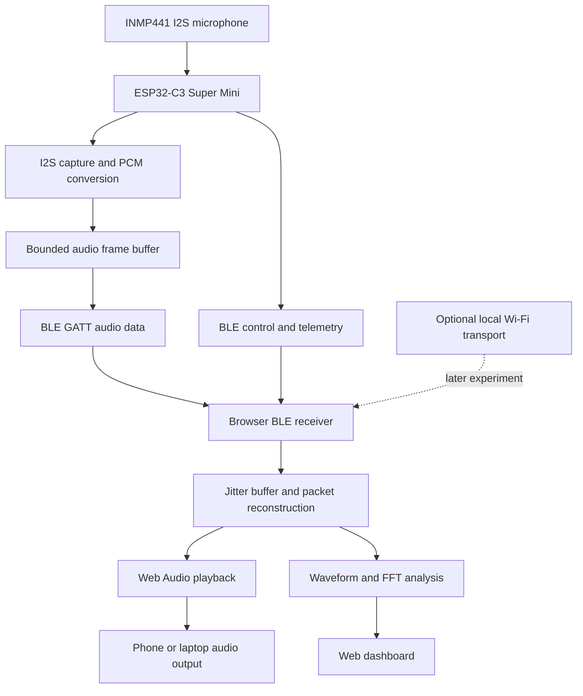

# System Architecture — Bluetooth First

## System boundary

The microphone transmitter and receiver communicate directly. The internet is not part of the runtime data path.

## Responsibilities

### ESP32-C3 transmitter
- Capture digital audio from INMP441 using I²S RX.
- Convert the microphone's native sample representation into a defined transport PCM format.
- Assemble bounded, sequenced audio frames.
- Send audio through a custom BLE GATT data characteristic.
- Expose a separate control/telemetry characteristic.
- Report buffer, capture and transport faults.

### BLE connection
- Advertising and device discovery.
- GATT connection and service discovery.
- Capability and audio configuration exchange.
- Audio notifications.
- Control writes and telemetry notifications.

### Browser receiver
- Connect using Web Bluetooth.
- Subscribe to BLE notifications.
- Validate and reassemble audio frames.
- Track sequence gaps and late packets.
- Feed a bounded jitter buffer.
- Play through Web Audio API / AudioWorklet.
- Calculate waveform, RMS, peak and FFT.
- Render status and diagnostics independently of audio rendering.

## Wireless policy

BLE is the default and primary connection. Wi-Fi is optional and disabled in the normal BLE mode. Wi-Fi may later be evaluated as a direct local SoftAP connection; it does not require internet, but it shares the ESP32-C3 2.4 GHz radio with BLE and simultaneous performance must be measured.

## Important platform limitation

ESP32-C3 supports Bluetooth LE, not Bluetooth Classic. This design is a custom BLE data application. It is not a standard Bluetooth headset, A2DP microphone or Bluetooth LE Audio endpoint.

## Performance boundary

BLE application throughput is lower than the PHY bit rate and depends on negotiated MTU, data length, connection interval, phone implementation, retransmissions and radio conditions. Published or laboratory throughput figures are not project acceptance evidence. The actual board-to-browser path must be benchmarked.
