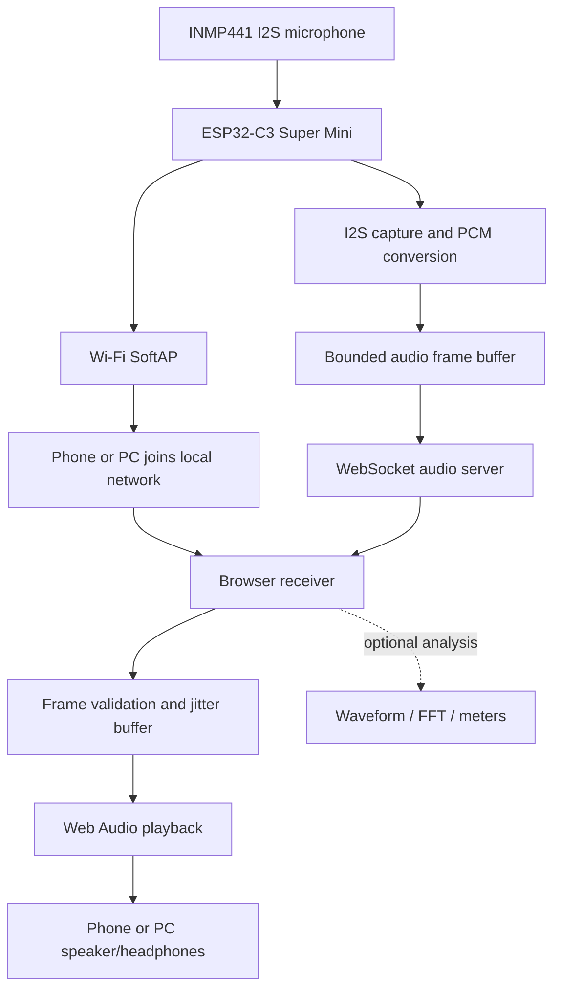

# System Architecture — Wi-Fi SoftAP + WebSocket

## System boundary

The ESP32-C3 creates a local Wi-Fi access point. A phone or PC connects directly to it. The receiver opens a WebSocket connection to the ESP32-C3 and receives audio frames. No internet connection or external router is required.

## ESP32-C3 transmitter responsibilities

- Configure Wi-Fi SoftAP with a documented SSID and configurable credentials.
- Serve or expose receiver connection information.
- Capture INMP441 audio through I²S RX.
- Convert microphone samples to a defined transport PCM format.
- Assemble sequenced audio frames in bounded buffers.
- Send frames to the WebSocket client without blocking I²S capture.
- Expose connection, capture and buffer diagnostics.
- Recover cleanly from receiver disconnects.

## Receiver responsibilities

- Join the DIY-Mic SoftAP.
- Open the configured WebSocket endpoint.
- Receive and validate binary audio frames.
- Handle sequence gaps and reconnects.
- Feed a bounded jitter buffer.
- Play audio using Web Audio API.
- Show connection and stream status.
- Optional: waveform, FFT, RMS and peak visualization.

## Network policy

The ESP32-C3 SoftAP is the default V0.7.0 connection. The local audio path is independent of internet access. Do not assume the phone can simultaneously retain mobile data or another Wi-Fi network while connected to the device; behavior varies by OS and device and must be tested.

BLE is not part of the initial audio transport. It may be evaluated later for discovery or control only if it provides a clear benefit.

## Performance boundary

Actual application throughput, packet timing, TCP/WebSocket buffering, radio range, current consumption and latency must be measured on the target board and receiver. Wi-Fi link rate is not equivalent to delivered audio throughput.